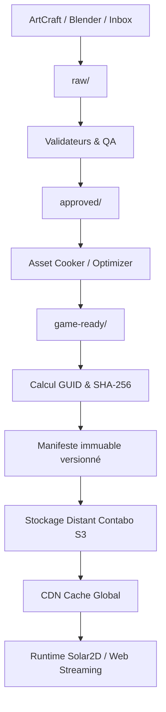

# Architecture Système

## Deux runtimes complémentaires

### 1. Runtime natif
- **Langage / Norme** : C++20 / C++23.
- **Rendu graphique** : WebGPU via `webgpu.h` (Dawn ou wgpu-native).
- **Cibles de déploiement** : Windows natif (.exe) et Web (WebAssembly via Emscripten).
- **Dimensionnalité** : 2D et 3D.
- **Composants clés** :
  - ECS : `flecs` avec métadonnées et réflexion.
  - Physique : `Box2D` (2D, M1+) et `Jolt Physics` (3D, M2+).
  - Scripting : `Lua 5.4` / `sol2`.
  - Mathématiques : `glm`.
  - UI de développement : `ImGui` (docking branch).

### 2. Runtime Solar2D (Jalon 4)
- **Langage** : Lua.
- **Cible de déploiement** : Mobile 2D (Android / iOS).
- **Fonctionnement** : Runtime client léger consommant des paquets d'assets distants versionnés.
- **Assets supportés** : PNG/WebP, JSON de scènes/données, audio OGG.
- **Limites** : Pas de 3D native, pas de GLB/PBR/Jolt. Consomme les exports générés par la chaîne d'outils.

## Flux d'assets & Ingestion

## Règles d'or d'architecture
1. **Identité par GUID** : Les scènes et entités référencent tous les assets exclusivement par GUID (RFC 4122 v4), jamais par chemin relatif ou absolu du système de fichiers.
2. **Immuabilité des artefacts publiés** : Chaque asset publié sur le CDN/S3 est immuable et identifié par son hash SHA-256 (`<guid>.<sha256>.<ext>`). Aucun fichier publié n'est modifié en place.
3. **Pointeurs dynamiques uniques** : `latest.json` est le seul fichier mutable servi par le CDN. Tous les autres manifests sont strictement versionnés (ex: `manifest-v1.0.4.json`).
4. **Pattern Command & Undo/Redo** : Toute action modifiant la scène dans l'éditeur passe obligatoirement par une commande réversible implémentant `ICommand` (`execute()`, `undo()`, `redo()`).
5. **Déterminisme et simulation** : Boucle de jeu à pas fixe (*fixed timestep*) pour la physique et la simulation, avec interpolation d'état graphique pour éliminer les saccades d'affichage (*jitter*).
